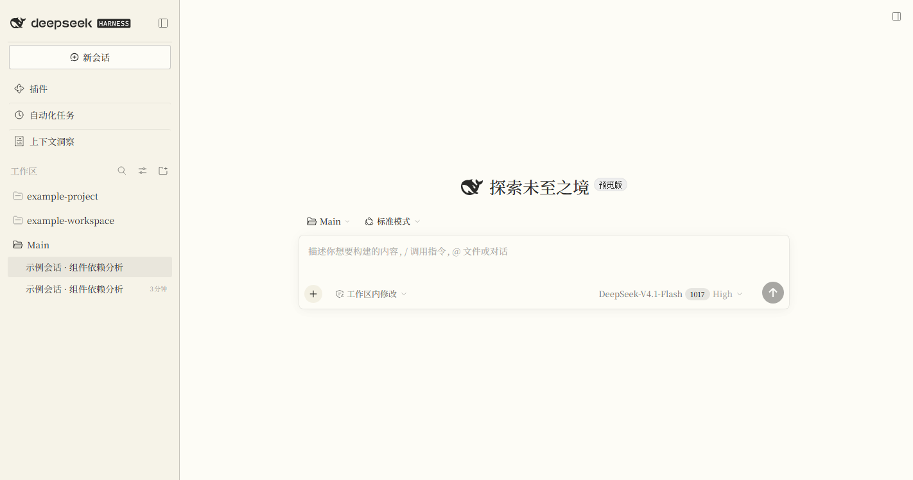
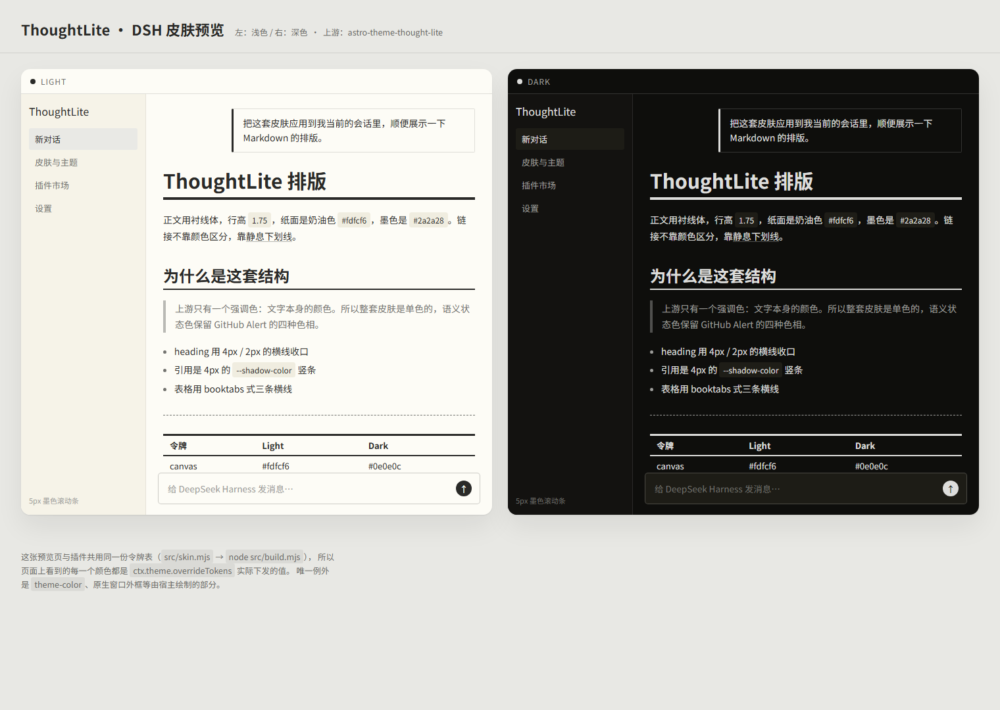

# ThoughtLite skin for DeepSeek Harness

[English](README.en.md) | **中文**

把 [astro-theme-thought-lite](https://github.com/tuyuritio/astro-theme-thought-lite) 的设计语言做成的一套 DSH 桌面版皮肤：**单色、纸面、衬线正文**的编辑部式重绘。

- 浅色：奶油纸面 `#fdfcf6` + 墨黑 `#2a2a28`（上游原值 `#fffffd`，见「偏差」）
- 深色：暖黑 `#0e0e0c` + 灰白 `#dddddb`
- 强调色 = 文字色（上游没有第二个颜色），链接靠下划线而不是颜色区分
- 唯一的彩色是状态色：沿用上游 GitHub Alert 的四种色相（tip `#48a131` / important `#3366cc` / warning `#bf8700` / caution `#ee3838`）
- **全站衬线**（Noto Serif 栈，外壳也在内）、代码 Maple Mono 栈 —— 上游 `body` 就是衬线，没有一处无衬线
- **方角**（2/3/4/5/6/8px）、发丝级边框、**无阴影**（只有浮层保留上游的 `shadow-md`）、5px 墨色滚动条



> 上图是真实 DSH 界面（账户信息与工作区名已打码）；下面这张是由同一份令牌表渲染的浅色/深色对照，也能直接打开 [preview/index.html](preview/index.html) 看。



---

## 安装

任意 profile 都行（`desktop` / `web` / 自建），把下面命令里的 profile 名换掉即可。

**从 GitHub 装（推荐）**

```powershell
dsh plugin --profile desktop add github:Jov3c/dsh-theme-thought-lite
```

**从 npm 装（发布后可用；插件市场也走这条路）**

```powershell
dsh plugin --profile desktop add dsh-theme-thought-lite
```

**从本地目录装（改皮肤时用）**

```powershell
dsh plugin --profile desktop add link:D:\Main\dsh-theme-thought-lite
```

然后**完全退出并重启 DeepSeek Harness**（关窗口不算，要退出进程）。重启后在「设置 → 通用 → 外观」里照常切浅色/深色/跟随系统。

> npm 上还没发：这台机器未登录 npm，发布是最后一步的手工操作。见「发布到 npm」。

- 这条命令会：把包写进 profile 的 `dependencies`、把 `dsh-theme-thought-lite` 追加进 `dsh.profile.bundles`（因为 package.json 里声明了 `dsh.bundle.patch`），并由 [cordis.patch.yml](cordis.patch.yml) 插入插件行。**不需要手改任何 profile 文件。**
- 卸载 / 回滚：

  ```powershell
  dsh plugin --profile desktop remove dsh-theme-thought-lite
  ```

  再重启即可回到原生外观。皮肤只注册一个令牌覆盖层和一个 `<style>`，二者随插件卸载自动移除，不改任何原文件。

### 手动安装（CLI 不可用时）

1. 在 `%USERPROFILE%\.dsh\profiles\desktop\package.json` 的 `dependencies` 里加：
   `"dsh-theme-thought-lite": "link:D:/Main/dsh-theme-thought-lite"`，
   并在 `dsh.profile.bundles` 数组末尾加 `"dsh-theme-thought-lite"`。
2. 在 profile 目录跑 `pnpm install`。
3. 重启。

---

## 它是怎么实现的

DSH 的皮肤扩展点是 `@deepseek-ai/dsh-client-ui-theme` 暴露的 **`ctx.theme.overrideTokens(source, tokens)`**：一个按「浅色/深色」成对的令牌覆盖层，叠在用户当前选中的内置主题之上。宿主 `ui-layout` 的 `ThemePresenter` 会把快照里的每个令牌以**内联自定义属性**写到 `<body>` 上，因此覆盖层永远赢过样式表、且随用户的外观选择自动切换。

所以本包是**皮肤（skin）而不是主题（theme）**：它不劫持浅色/深色的选择权，只是把两种模式都重绘一遍。

```
lib/client.js   ← 浏览器半：一次 overrideTokens + 一个 <style>（由 src/build.mjs 生成）
lib/index.js    ← 宿主半：空实现（浏览器专用插件，与官方 ui-layout 同构）
src/skin.mjs    ← 唯一真源：上游锚点 → DSH 令牌映射 + 签名样式
```

- 令牌分两层打：**静态色阶**（`--dsw-static-*`，先铺一层暖色纸感，兜住所有没点名的引用）+ **语义别名**（`--dsw-alias-*`，逐个点名，保证精确）。
- 不改布局、不改组件结构；签名样式只作用于 Markdown 阅读面（见下）。
- 一切挂在 `ctx.effect` 生命周期上；`apply()` 全体包了 try/catch，**皮肤失败不会把 GUI 带崩**。

共覆盖 **256 个令牌**，其中包含 DSH 设计系统中 `design-platform` 的全部 190 个。

---

## 设计映射

上游整套调色板就是 [src/styles/global.css](https://github.com/tuyuritio/astro-theme-thought-lite/blob/main/src/styles/global.css) 里的 7 个变量，其余是 Tailwind v4 CSS-first。映射原则：

| 上游 | DSH 令牌 | 处理 |
|---|---|---|
| `--background-color` `#fffffd` / `#0e0e0c` | `--dsw-alias-bg-base`、`-bg-layer-*`、`--dsw-static-neutral-bluish-00/950` | 压成奶油 `#fdfcf6`（见「偏差」） |
| `--primary-color` `#2a2a28` / `#dddddb` | `--dsw-alias-label-primary`、`-brand-*`、`-link`、`-state-business-primary`、`-button-primary-fill` | 原值；**强调色整体塌缩成墨色** |
| `--secondary-color` `#7e7e7b` / `#9e9e9b` | `--dsw-alias-label-secondary`、`-border-*` 基准、`li::marker` | 浅色微调到 `#73736f`（见「偏差」） |
| `--weak-color` `#9f9f9c` / `#5d5d5a` | `--dsw-alias-label-tertiary`、`-label-dimmed` | 原值 |
| `--block-color` `#eeeeee` / `#1e1e1e` | `--dsw-alias-markdown-code-block`、`-inline-code`、`-specific-bubble` | 原值（正是上游的代码/内联块底色） |
| `--shadow-color` `#cdcdcc` / `#323231` | `--dsw-alias-border-l4`、blockquote 竖条、focus ring | 原值 |
| `--selection-color` `#adadacc3` | `--dsw-alias-bg-document-selection`、`::selection` | 原值（上游两种模式同值） |
| Alert 色相 | `--dsw-alias-state-success/warn/error-*`、file-diff | 只换色相，语义不变 |
| Shiki `github-light` / `dark-plus` | `--shiki-token-*` | 上游 `astro.config.ts` 里就是这两个主题，按它们的规范色写 |
| Noto Serif 栈 | `--dsh-font-family-text-default`（全站）+ `--dsw-font-markdown-*-font-family`（22 个） | 上游 `body` 无一处无衬线，所以外壳也衬线 |
| Maple Mono 栈 | `--ds-font-family-code`、`--dsh-font-family-code-default` | 原值 |
| 圆角 5px / 0.3em | `--dsw-radius-*`（2/3/4/5/6/8） | 由 4–28px 收成方角 |
| 平铺无阴影 | `--dsw-shadow-lv1/lv2` = `none`、`lv3` = 上游 `shadow-md`、`--dsw-menu-backdrop-filter: none` | 只给浮层留投影，菜单改实心纸面 |

**签名样式**分两类，全部挂在 `fixtures/dsh-css-modules.json` 登记过的钩子上（`verify` 会拦住未登记的钩子）：

阅读面 `[class*="_markdown_"]`：

- `h1` 4px、`h2` 2px 的 `currentColor` 收口横线；标题阶梯放大到 30/24/20/17px（上游 36/28/24 在 14px 正文上的等比）
- 链接继承墨色 + 32% 静息下划线，悬停变实，`0.05em` 粗 / `0.15em` 偏移
- `hr` 是 `--secondary` 的虚线发丝
- 引用是 4px `--shadow-color` 竖条，不加斜体不加底色
- 内联代码 `0.3em` 圆角 + `.25em/.5em` 内边距；围栏块 `.3em` 圆角 + 发丝描边
- 表格 booktabs 化：上下 3px 主墨线、表头下 2px
- `mark` 改成波浪下划线（上游做法）；阅读面行高 1.75，标题上下留白加大

结构面（这几条才让应用不再像聊天客户端）：

- **用户消息不再是气泡**：`[class*="_bubble"]` 改成透明底 + 左侧 3px 墨线 + 2px 方角的编辑部式块
- **输入区是表单不是浮卡**：`[class*="_composerStack"] [class*="_input"]` 收到 2px 圆角
- **侧栏报头**：`[class*="_logoRow"]` 下方加一条发丝横线，像博客站头
- **侧栏条目**：`[class*="_panelRow"]` 变规整列表（2px 圆角 + 条目间发丝分隔）

### 为什么不会和用户设置打架

`ui-theme` 的字体绑定是 `--dsw-font-family: var(--dsh-font-family-text, var(--dsh-font-family-text-default)), …`。皮肤只覆盖 `--dsh-font-family-text-default` 这个**兜底栈**，不覆盖 `--dsw-font-family`，所以用户在设置里自选的字体永远优先；字号同理，一个字都没碰。

---

## 偏差（有意为之，逐条说明）

1. **纸面从 `#fffffd` 压成奶油 `#fdfcf6`**：上游的"暖白"在纸面上其实就是白，而原生 DSH 也是白——两者放一起看不出差别。奶油化是让"纸感"真正可见的最小改动；正文对比度仍 ≥13:1。
2. **`label-secondary` 从 `#7e7e7b` 调到 `#73736f`**：上游这个值在自己纸面上只有 4.07:1，低于 WCAG AA；奶油底上再压到 `#73736f` 才守住 4.5:1（4.63:1）。其余对比度全部合规（`node test/verify.mjs` 会逐个算）。
3. **焦点环用 `--secondary` 而不是 `--shadow-color`**：上游拿 `#cdcdcc` 当 2px 焦点环，在纸面上几乎看不见；换成同族的 `--secondary` 保可用性。
4. **滚动条墨色降到 19%/35% 透明度**：上游是 100% 不透明的墨色 5px 轨道，在博客单页上很干净，但在多滚动区的应用里过重。
5. **链接保留一条 32% 的静息下划线**（悬停变实）：上游是 hover 才显形。在博客里没人需要"这行是不是链接"，在会话里需要——这是为了可用性放弃的一点纯粹性。
6. **标题阶梯按 14px 正文等比放大**（30/24/20/17px）：上游是 36/28/24，但换算到 DSH 的 14px 正文就只剩 21/19/18，出不来看头；这是"像博客"的关键一档。
7. **结构改动（气泡 / 输入框 / 侧栏）**：上游根本没有这些容器，这是**把上游的编辑排版语言翻译成 GUI**，不是原样搬运——用户消息变成带墨线的引文块、侧栏加报头横线、条目改规整列表。
8. **品牌色不是发明出来的**：上游没有强调色，所以把 DSH 的品牌/链接/主按钮一律塌缩成墨色；没有借 GitHub Alert 的蓝色来充当品牌色，那会破坏单色气质。

---

## 字体

按「装了就用、没装就优雅退化」处理，不下载网络字体（桌面版离线可用是硬要求）：

- 正文衬线：`Noto Serif SC → Noto Serif → Source Han Serif SC → Songti SC → STSong → SimSun → Georgia → Times New Roman → serif`
- 代码：`Maple Mono NF CN → Maple Mono NF → Maple Mono → Cascadia Code → JetBrains Mono → Consolas → Monaco`
- 外壳：系统 UI 栈（Segoe UI Variable / PingFang SC / 微软雅黑）

想要最接近上游的观感，装 [Noto Serif SC](https://fonts.google.com/noto/specimen/Noto+Serif+SC) 与 [Maple Mono NF CN](https://font.zeoseven.com/442/main/result.css)；不装也能用（Windows 会退化到宋体，代码退化到 Cascadia/Consolas）。

顺带一个建议：衬线体在 14px 偏小，**设置 → 通用 → 字号大小**调到 15–16px 最舒服（皮肤不替你改这个值，它是你的偏好）。

---

## 验证

```powershell
cd D:\Main\dsh-theme-thought-lite
node src/build.mjs         # 生成 lib/client.js、预览、fixture
node test/verify.mjs       # 73 项：包本身
node scripts/preflight.mjs # 23 项：装进 profile 之后，宿主能不能加载它
```

`verify.mjs` 用假 `window.__ModuleLoader__` 与假 `ctx` 真正把包跑一遍，检查：

- 模块加载协议（id / factory / exports / `inject: ["theme"]`）
- `apply()` 只叠一层、样式只挂一份、都挂在 `ctx.effect` 上、重复 apply 不重复叠层
- 每个覆盖值都是 `{light, dark}` 非空字符串（裸字符串会在 API 边界抛错）
- **覆盖了 `design-platform` 全部 190 个令牌**，且没有拼错的名字
- 没有指向未定义令牌的 `var()`；产物与源码同步（不是过期构建）
- **17 组前景/背景 × 2 种模式的 WCAG 对比度**（正文 ≥7:1，次要文本/按钮/toast ≥4.5:1，状态色 ≥3:1）
- 签名样式依赖的 `_markdown_` / `md-code-block` / `data-ds-dark-theme` 钩子在本机 DSH 版本里仍存在
- 清单字段（`main`、`exports["./client"]`、`dsh.client.platform`、`dsh.bundle.patch`、patch 插入行）

`preflight.mjs` 在**安装之后**按宿主的真实解析路径再核对一遍：从 profile 的 `node_modules` 解析包、用 `client-modules` 的同一套规则校验 `dsh.client`、解析 `exports["./client"]`、确认 bundle 是经典脚本且注册 id 等于包名（决定它是否被挂到 `/plugins/<id>/client.js`）、确认宿主半导出 `apply`、确认它排在 bundle 栈末位（覆盖层才压得住前面的层）。

`fixtures/dsh-tokens.json` 与 `fixtures/dsh-frontend.css` 是从本机安装的 DSH（`0.2.1-rc.2`）里导出的令牌清单与前端样式，用来对齐版本。**DSH 升级后请重新导出并重跑 verify**：

```powershell
node scripts/extract-dsh-tokens.mjs <解包出的 ui-theme 样式目录> fixtures/dsh-tokens.json
```

---

## 重启后没生效？

先分清是「服务端没加载」还是「页面没更新」。两者症状不同，处理也不同。

### 1. 确认服务端侧（十几秒）

宿主对已开着的页面走一条 SSE 通道推送客户端模块图，这条例外路由不需要 token：

```powershell
node D:\Main\dsh-theme-thought-lite\scripts\graph-probe.mjs
```

输出里出现
`"id":"dsh-theme-thought-lite","url":"plugins/??dsh-theme-thought-lite/client.js&rev=…","immediately":true`
就说明**宿主已经把它编进了图**，问题在页面侧，往下看。

### 2. 页面侧：桌面外壳会缓存启动页

桌面版把 shell 从自己的 `dsh-app://` 方案加载，那份 HTML 里内联着 `window.__DSH_BOOT__`（客户端模块图）。
它是可缓存的——**在装插件之前打开过的窗口，下次启动可能仍拿到旧的启动图**，于是新插件虽然在服务端图里、页面却没有去加载它。

三个解法，从轻到重：

1. 在窗口里按 **Ctrl+Shift+R** 强制刷新（不是普通 F5）；
2. 让宿主推新图：给 bundle 换一次修改时间，宿主会把它当成重建并推给已开页面，页面热加载皮肤（**不用重启**）：

   ```powershell
   (Get-Item D:\Main\dsh-theme-thought-lite\lib\client.js).LastWriteTime = Get-Date
   ```

3. 彻底清缓存：退出应用，删掉
   `%APPDATA%\@deepseek-ai\dsh-desktop\Cache`、`Code Cache`、`GPUCache` 三个目录，再启动。

### 3. 怎么一眼确认生效了

拿不准是不是「其实已经生效但我没看出来」时，对比这两张真实截图（同一台机器、同一个会话、同一页面）：

| | 皮肤生效 | 原生外观 |
|---|---|---|
| 字体 | **全站衬线**（宋体/Noto Serif），连侧栏、导航、输入框都是 | 系统无衬线黑体 |
| 用户消息 | **带 3px 墨线引文块**，透明底、方角 | 蓝色圆角气泡 |
| 侧栏 | 品牌字下方**报头发丝线**，条目是规整列表 | 无线，条目是圆角胶囊 |
| 标题 | h1 30px / h2 24px，带 4px / 2px 收口横线 | h1 21px / h2 19px，无横线 |
| 圆角 | 方角，面板 8px（`--dsw-radius-panel`） | 胶囊级，输入框/面板 24–28px |
| 阴影 | 无（`--dsw-shadow-lv1/lv2: none`） | 各层都有柔投影 |
| 背景 | 奶油纸面 `#fdfcf6`，侧栏 `#f6f3e8` | 纯白 `#ffffff` |
| 发送键 / 主按钮 | 墨色（墨色是唯一强调色） | 蓝色 |

这三条是最容易确认的：**用户消息从蓝色圆角气泡变成带墨线的引文块**、**整站字体变成衬线**、**背景从纯白变成奶油色**。配色与排版见顶部 [docs/preview.png](docs/preview.png)（浅色/深色并排）。

> 本地验证方法：用 CDP 驱动无头 Chrome 打开一个临时 web 实例，先抓生效态，再在页面里摘掉皮肤的 `<style>` 并剥掉全部内联令牌抓原生态——就能得到同页面 A/B。截图含账户与工作区信息，所以没有入库。

### 4. 插件列表里能看状态

**设置 → 插件**的列表会显示页面侧的同步失败（如果 bundle 执行失败），并提供「重试」而不改动宿主启用状态。列表里有 `dsh-theme-thought-lite` 且无报错，就说明页面已加载成功。

---

## 发布到 npm

仓库里已经做好了发布准备（`private` 已移除、`publishConfig.access=public`、`repository`/`homepage`/`bugs` 已填、`prepublishOnly` 会先重建再跑 73 项校验），剩下的只是登录与发布：

```powershell
cd D:\Main\dsh-theme-thought-lite
npm login                 # 浏览器里登录你的 npm 账号
npm publish               # prepublishOnly 会自动先构建并校验
```

`dsh-theme-thought-lite` 这个包名目前未被占用。发到 npm 之后，DSH 的插件市场（dshmarket）才能索引到它；包里的 `dsh` 清单字段与 keywords 已按市场扫描习惯填好。

---

## 已知限制

- **不是设置里的第三个选项**：`ui-theme` 的设置 schema 只接受 `light` / `dark` / `system`，第三方主题 id 不跨设置边界。所以皮肤是「一直生效的覆盖层」，开关等于装/卸插件。
- **首帧可能闪一下原生配色**：令牌覆盖发生在插件挂载后。`immediately: true` 让它尽早加载，但早不过 DSH 自己的 pre-plugin bootstrap。
- **不覆盖宿主绘制的部分**：原生窗口标题栏/边框、托盘图标、安装向导不在这套令牌体系里。
- **`_markdown_` / `_bubble` / `_logoRow` 等是哈希类名的一部分**：DSH 如果改掉这些 CSS-module 命名，对应的签名或结构样式会失效（颜色不受影响，因为颜色走令牌）。所有用到的钩子都登记在 `fixtures/dsh-css-modules.json`，`verify` 会拦住"用了没登记的钩子"；升级后照它逐个核对。
- 上游是 GPLv3。本包**只搬设计值**（颜色、字号、规则），不含上游任何代码，故以 MIT 发布；如果你想再分发这套视觉，请自行核对上游许可与署名要求。

---

## 致谢

- 设计：[tuyuritio/astro-theme-thought-lite](https://github.com/tuyuritio/astro-theme-thought-lite)（GPLv3）
- 字体：[Noto Serif](https://fonts.google.com/noto/specimen/Noto+Serif)（OFL）、[Maple Mono NF CN](https://font.zeoseven.com/)（OFL）
- 集成面：`@deepseek-ai/dsh-client-ui-theme` 的 `ctx.theme` 扩展点
